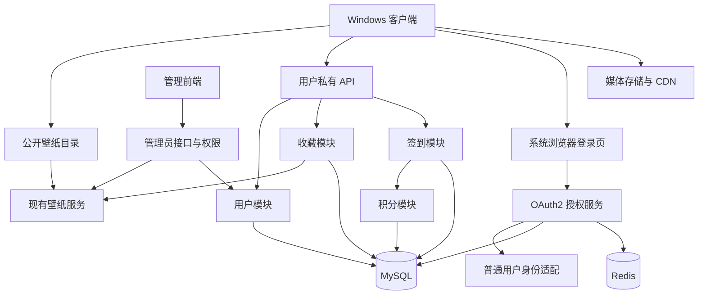

# 光影壁纸 Windows 客户端：账号、收藏与成长体系方案

> 历史方案稿：首版产品范围及验收以 [光影壁纸 Windows 客户端首版 PRD](光影壁纸Windows客户端首版PRD.md) 为准。本文保留账号与后续成长体系的设计背景；M0 的最新实现状态见 [安全续期进展](M0安全续期实现进展.md)。

版本：v1.2 · 2026-10-30 · 状态：首版产品基线已确认；M0 兼容性验证已发现适配缺口，完整登录尚未实施

M0 证据与验收状态见 [账号认证验证报告](M0账号认证验证报告.md)。11 项组件及过滤器测试通过不代表首版登录可上线；公共客户端续期、完整路由隔离及强制改密仍需适配。

客户端：`D:\breadj-wallpaper-windows`  
后端：`D:\IdeaProjects\light-shadow-wallpaper-admin`  
管理前端：`D:\WebstormProjects\light-shadow-wallpaper-client-admin`

## 本轮确认与优先级（2026-10-30）

用户原则：**先保留可扩展，简单做，尽量根据现有能力实现，不一下做大而全。** 下列确认覆盖后文早期建议中的冲突描述，其余详细技术设计仍为候选方案，不是必须全部实现的清单。

- 游客可浏览、预览、下载及设置公开壁纸；登录用于云端收藏和个人数据。
- 首版必须打通浏览 → 登录收藏 → 下载 → 设置桌面，原 M1b 并入首版交付。
- 登录体验目标：实际使用滚动延长登录，连续六个月无实际使用才过期；后台自动刷新不计活跃。主动退出、冻结或凭据撤销可使登录失效。现有固定 30 天候选须适配并重验，不能用频繁重新打开浏览器代替该体验。
- 已确认复用 `sys_user` 的 CUSTOMER，收藏关联既有 userId。首版按正式运营规划，由管理员开通普通账号并重置遗忘的密码，暂不提供自行注册和找回。
- 收藏首版只有一个默认列表，联网写入、刷新同步，不做多收藏夹或离线写队列。下架/删除内容保留不可用占位并允许取消，已下载文件继续保留和使用。
- 管理员开通/重置生成独立临时密码，使用者首次登录后必须修改；重置撤销旧登录，管理员不查看使用者后续设置的密码。
- 签到和积分后续再实现；积分用于装饰或额外功能，具体兑换项未定，基础壁纸使用保持免费。
- 复用现有服务、账号扩展点与组件；普通用户不得获得后台管理权限。不新建独立账号表，PKCE 如何接入、是否新增目录路由仍需按实际缺口确定。

已沉淀到根目录 `GLOSSARY.md` 与 `docs/adr/0001-public-wallpapers-and-account-boundaries.md`、`docs/adr/0002-customer-accounts-with-admin-provisioning.md`。

### 后端能力补充核查（2026-10-30）

本机打包依赖中可见 Ballcat 1.4.2、Spring Boot 2.7.12、Spring Security 5.7.8 与 SAS 0.4.2；这是本地打包证据，不代表线上运行版本。

| 能力 | 本次核查结论 | 对最小方案的影响 |
| --- | --- | --- |
| 用户类型 | 已有 SYSTEM=1、CUSTOMER=2 | 优先评估复用 CUSTOMER，无需先新建独立账号平台 |
| CUSTOMER 隔离 | 默认按用户名加载用户，启用状态不检查类型；资源链默认要求已登录，类型本身不隔离管理接口 | 复用前必须补管理员入口/接口和普通用户 API 的主体边界 |
| 后台创建用户 | `SysUserServiceImpl.addSysUser` 强制写 SYSTEM；角色按显式 roleCodes 分配 | 后台现有新增按钮不能直接开通 CUSTOMER，需专用最小开通路径，禁止接受任意角色输入 |
| 登录与刷新 | 已有密码登录/刷新机制；breadj_client_web 示例配置 access 1 天、refresh 30 天，默认复用刷新令牌 | 只证明配置样例；固定 30 天不是每次使用续满 30 天，仍需验证桌面安全接入及真实配置 |
| 公开注册和找回 | 未找到现成公开注册、邮箱/短信验证码或自助找回实现 | 首版由管理员开通，暂不提供自行注册或找回 |
| 邮件和短信 | 依赖包含邮件通知类但缺少可用装配证据；短信通知实现仅打印 | 不视为已具备邮箱/手机注册能力，首期不预设供应商接入 |

已确认采用：复用 CUSTOMER 加必要权限隔离，通过专用管理员开通和重置密码支持正式运营。后续确需自行注册时，再补最小流程与必要校验，不将其视为现成能力。

额外边界：依赖中的管理员判定按配置 userId/username，未见按 type 限定；普通账号创建必须排除管理员保留身份。默认刷新流程未见重新加载用户状态，改密、冻结和退出需主动撤销已有授权并验证实际失效。用户名是否全局唯一须核实数据库索引，不能假定不同类型允许重名。

## 1. 方案结论与范围

在现有 Java 后端中新增面向普通用户的业务模块，复用壁纸数据、MySQL、Redis、对象存储及已有授权服务基础设施。Windows 客户端增加“在线壁纸、我的收藏、个人中心”，支持游客浏览、登录、收藏同步，并衔接现有本地壁纸库。

账号、收藏为本次明确需求。签到、积分和成长体系采用下面的完整业务边界设计，按阶段实现；首期不必创建尚未使用的积分表、任务引擎或消息队列。

候选技术决策（须按上述原则核查后收敛）：

1. 普通用户复用 `sys_user` 的 CUSTOMER，不新建独立 member 账号表，也不直接开放后台新增用户接口。
2. 普通用户与管理员共用授权服务进程，但账号来源、令牌权限及可访问接口隔离。
3. 公开目录与用户私有数据分开。现有 `/rest/**` 保持兼容；新增私有接口使用 `/client/v1/me/**`，不能放入匿名白名单。
4. 收藏是服务端用户数据，下载是本机文件状态，两者独立。
5. 签到、奖励流水和余额在单个 MySQL 事务中完成，唯一约束保证重试不重复领奖。
6. 当前采用一个部署单元内的业务模块，不引入微服务。将来确有独立负载或团队边界时，再从既定接口拆分。

## 2. 已核实的项目现状

截至本次源码检查：

| 项目事实 | 依据与影响 |
| --- | --- |
| 后端是 Ballcat 1.4.2 Maven 多模块，当前只有 `admin` 业务模块 | 根 `pom.xml`；本方案先增加 Java 包，不拆 Maven 服务 |
| 同时开启授权服务器与资源服务器 | `AdminApplication` 上两个 OAuth2 注解 |
| 已有 OAuth2 客户端注册示例与 reference token 配置 | `OAuth2RegisteredClientTest`；示例不等于生产已配置 |
| 旧 `breadj_client_web` 示例使用 client secret、password grant 及跳过验证码 scope | 不适合作为桌面应用直接照搬的登录契约 |
| `/rest/**` 配置为放行路径 | 新增用户私有接口必须另设受保护路径 |
| 已有壁纸公开分页及图片/视频资源 | `WallpaperRestController`；可继续复用查询服务 |
| 后台用户由 Ballcat 依赖提供，项目使用 `SysUserMapper` | 已有 CUSTOMER 类型；未发现公开注册或收藏、签到、积分业务实现 |
| Windows 已有 DPAPI CurrentUser 加密工具 | `EncryptUtil`；可复用加密能力，账号凭据使用独立存储路径 |
| 现有 Lively 图库有自己的登录及 ZIP 下载契约 | 不将新账号与 Lively 原图库账号混在同一 Token 文件里 |

本次未连接数据库、未读取生产配置值、未运行登录联调。表名、路由和 DTO 中的新增部分都是拟定契约；SDK 能力以项目实际解析的依赖版本验证为准。

## 3. 产品分期

| 阶段 | 用户能力 | 后端交付 | 发布门槛 |
| --- | --- | --- | --- |
| M0：技术验证 | 内部测试账号完成浏览器登录 | member 身份接入现有 SAS、PKCE 公共客户端、权限隔离验证 | 无 secret 换码、回调校验、member 无法访问后台 |
| M1：首版完整闭环 | 游客浏览、预览、下载设置；登录、退出、收藏/取消及跨设备刷新 | 复用已验证的账号能力、收藏关系与壁纸服务；账号开通/恢复方式按后端能力决定 | 实际使用滚动延期与连续六个月不活跃过期、权限隔离、收藏并发及实际媒体播放通过 |
| M1 内部步骤：本地使用 | 下载、加入本地库、设为壁纸、展示本地下载状态 | 复用目录详情与媒体地址，按需补资源可用性接口 | 必须随首版验收，图片/视频取消失败处理及多屏回归通过 |
| M2：签到 | 今日签到、连续天数、月历 | 签到记录、服务端时区、并发幂等；初期可不发积分 | 跨天、多设备同时签到均只生成一条记录 |
| M3：积分和成长 | 签到奖励、余额与明细 | 积分账户、不可变流水、规则版本与审计 | 同一奖励最多入账一次、余额与流水对账通过 |
| 后续按需 | 任务、收藏夹、等级、权益 | 接入既有 member ID 与积分业务接口 | 每种新增权益独立定义发放、撤销、审计规则 |

下载与设置已确认为首版交付，收藏功能不代表“已经下载或已经设为桌面”。注册/登录不是公开内容使用前提；签到与积分不限制基础壁纸使用。

## 4. 页面与关键交互

### 4.1 信息架构

主导航建议为：本地壁纸、在线壁纸、我的收藏、个人中心。个人中心内放账号资料和安全设置；签到上线后加入签到卡片，积分上线后加入余额与流水。服务端能力关闭时隐藏相应入口，不显示尚未实现的按钮。

在线列表沿用原 PRD 的分页、搜索、图片/视频筛选、封面及详情规则。新增心形收藏按钮，详情页与列表共享同一收藏状态。

### 4.2 登录前后

- 游客点击收藏时，保留待执行的一次动作并引导登录；成功后重新校验壁纸可见性，再执行该动作。
- 取消登录返回原页面，不把待执行收藏显示为已完成；应用重启不自动重放历史动作。
- 登录后显示昵称、头像占位及账号状态；首页不依赖后台菜单接口生成。
- Token 失效时，收藏、签到等私有操作要求重新授权；公开浏览与已下载壁纸继续可用。
- A 账号退出或切换 B 账号时，清空 A 的私有视图、缓存与待执行请求。晚到的 A 响应不能写入 B 的界面。
- 收藏操作采用服务端成功后更新的方式，同一壁纸操作期间禁用重复点击；失败保留原状态并提供重试。

### 4.3 收藏

已确认：收藏按最近收藏时间倒序，默认每页 20 条。首期一个默认集合，不创建多收藏夹，不做离线操作队列；跨设备通过刷新同步。

收藏列表显示壁纸及状态：正常、已下架、已删除。下架/删除项保留收藏关系，显示最小标题快照和占位图，允许取消，不返回失效项的媒体直链。取消收藏不删除本地文件；删除本地文件不取消收藏。

同账号多设备在进入页面、恢复前台及手动刷新时重新取数；首期不使用 WebSocket 实时同步。离线可浏览本次已展示内容，收藏写操作明确提示需要联网，不创建离线写入队列。

## 5. 系统架构与模块职责

以上组件先运行于现有 `admin` 应用。图中的职责边界对应包和服务接口，不代表独立部署。

建议在现有根包下增加 `member`、`favorite`、`checkin`、`points`，每个包按项目惯例包含 controller、service、mapper、model。签到与积分包在相应阶段创建；客户端 API 控制器在对应业务包内，避免新增一套重复业务层。

| 模块 | 唯一负责的事情 | 不承担的事情 |
| --- | --- | --- |
| 身份适配 | 登录凭据验证、主体类型、授权会话 | 收藏、签到判断 |
| member | 资料、状态、账号生命周期 | 后台菜单与管理员角色 |
| wallpaper | 壁纸可见性、元数据、有效媒体资源 | 用户登录与积分规则 |
| favorite | 当前用户与壁纸的收藏关系 | 下载任务或壁纸副本 |
| checkin | 业务日期、签到事实、连续天数 | 直接任意修改积分余额 |
| points | 统一入账/扣减、幂等流水、余额 | 计算所有活动的营销规则 |

公开接口与收藏列表共享壁纸可见性判定；不能各写一套 `status` 规则。客户端、后台及未来 Web/小程序使用同一稳定 member ID；不同终端分别注册 OAuth2 client。

## 6. 身份、登录与账号生命周期

### 6.1 普通用户与后台用户

已确认复用 `sys_user` 中的 CUSTOMER，普通用户不授予后台角色，不新建 `client_member`。后文概念性的 member/memberId 均指普通用户及其既有 userId，不代表第二套身份或必须新增的模块。

无论选哪种存储方式，必须在服务端识别普通用户/管理员，验证授权上下文恢复及用户状态，禁止仅凭桌面传入 `memberId` 或 `client_id` 决定身份。复用 CUSTOMER 时，账号 ID 直接使用既有 userId，不强制增加一套 MEMBER/ADMIN 主体名或第二个认证 Provider。

管理员入口/接口只接受授权管理员，普通用户私有 API 只接受 CUSTOMER；必须覆盖缺少 `@PreAuthorize` 的已登录接口。内建 type 字段本身不等于完成上述隔离。普通用户开通不能直接调用强制 SYSTEM 的后台新增逻辑，更不能接受客户端指定角色。

桌面注册为公共客户端 `breadj_windows`，scope 最小集合为 `profile`、`favorites:read`、`favorites:write`；签到上线再加 `checkin:read/write`，积分上线加 `points:read`。Scope 表示令牌用途，不能代替用户归属检查。

资源端还需核验令牌是允许的客户端、有效的 MEMBER 主体且用户未冻结；任何 MEMBER Token 均不得进入管理员命名空间，即使某个管理接口只有“已登录”检查。实施前枚举现有管理路由，加入主体隔离规则；不能只依赖成员没有菜单。

### 6.2 桌面登录协议

采用系统浏览器 + Authorization Code + PKCE S256，桌面不内置共享密钥，也不直接收集用户密码。外部浏览器和 PKCE 是原生应用的推荐路径，依据 [RFC 8252](https://www.rfc-editor.org/rfc/rfc8252) 与 [RFC 9700](https://www.rfc-editor.org/rfc/rfc9700)。旧 password grant 文档保留给既有系统，本次不作为新桌面登录标准。

1. 客户端创建随机 `state`、PKCE verifier/challenge，只保存在本次登录内存上下文。
2. 先监听 `127.0.0.1` 回调，再打开服务端普通用户登录页面，携带 client、scope、redirect URI、state、challenge。
3. 服务端验证 member 账号，建立独立 member 浏览器会话，再批准授权请求。
4. 回调仅接收本次 `state` 对应的一次授权码；客户端用 verifier 换取 Token，随后调用 `/client/v1/me` 验证主体。
5. 登录结束或超时立即关闭监听并销毁 verifier；取消、端口占用和应用重复启动有明确错误路径。

回调路径建议 `/oauth/callback`。优先 loopback 随机端口；须验证当前授权服务对已注册 loopback 地址的端口匹配能力。若不支持，使用一个明确注册的固定本地端口，端口占用时中止登录并提示，不扩大到任意重定向地址。除 loopback 回调外均使用 HTTPS。

浏览器中的 MEMBER 会话与管理员会话使用独立认证上下文/会话策略；成员登录不能把管理员会话降级，管理员会话也不能直接授权生成 member 身份。需要在实际安全过滤链中证明隔离。

### 6.3 Token、记住登录与退出

[Spring Authorization Server 的 PKCE 指南](https://docs.spring.io/spring-authorization-server/reference/guides/how-to-pkce.html) 明确提醒其公共客户端不签发 refresh token。该文档是现行版本指南，不能证明本项目 Ballcat 旧版本行为相同。

**2026-10-30 体验目标已更新为实际使用滚动延长登录、连续六个月不活跃过期；后台自动刷新不计活跃。** M0 必须核查现有授权方式、刷新令牌及客户端安全边界，再选择满足目标的最小实现。不能将访问令牌直接延长至六个月，也不能在桌面内置共享密钥来绕过公共客户端限制。

早期“30 分钟令牌 + 7 天浏览器会话、过期后再授权”的建议不再作为首版验收基线。若既有授权组件无法满足目标，先说明具体缺口并讨论最小补充，不提前建设新的认证平台。

- 复用 `EncryptUtil` 的 DPAPI CurrentUser，LightShadow 凭据独立命名并按环境隔离，不覆盖 Lively `TokensPath`。
- 授权恢复使用单次在途协调；收到 401 后最多尝试一次已授权恢复，取消后停止。403 显示权限或封禁原因，不能无限重新登录。
- Token 仅发往本服务受保护 API；下载 CDN 媒体不携带 Token，也不把 Token 放入 URL 或日志。
- “退出本机”：撤销当前授权/Token、清空本机私有数据，并使成员浏览器会话退出；不能只删除本地文件而让下一次点击立即无感登录旧账号。
- “退出全部设备”、改密、找回密码：撤销该 member 的全部授权与浏览器会话。若注销时网络失败，本机立即清理，同时提示远端撤销未确认；访问 Token 最长仍有效到其过期或服务端撤销。
- 私有请求逐次核验用户状态；冻结立即禁止私有操作。不得仅依赖长期缓存的 Token 用户状态。

### 6.4 管理员开通账号与密码恢复

首版不提供公开注册、邮箱/短信验证及自助找回密码。管理员通过受保护的专用入口开通 CUSTOMER，使用现有密码哈希能力；服务端固定普通用户类型，不接收任意角色或管理权限字段，并排除管理员保留身份。不能直接复用强制写 SYSTEM 的现有新增方法。

忘记密码由管理员核实使用者身份后重置；不得返回或展示旧密码。开通/重置为每个账号生成独立的随机临时密码，通过受控渠道交给对应使用者，不保存或记录明文密码。重置需要审计，并撤销该账号已有授权，使旧登录失效。

已确认首次登录后必须修改临时密码。改密完成前，只允许必要的账号状态、改密和退出操作，服务端拒绝收藏等私有业务请求；不能仅在 Windows 弹出修改提示。使用现有密码校验/哈希能力，必要时补一个最小的强制改密状态，不建立新凭据体系。改密成功撤销临时授权，再进入正常登录态；自动恢复是否可复用既有授权流程由 M0 验证。管理员不能查询使用者随后设置的密码。

冻结、解冻和会话撤销复用现有能力补齐缺口。首版账户关闭先走管理员处理；以后若提供自行注册，再确定身份验证、自助恢复及账户注销流程。未来扩展不能改变已有收藏的用户归属，也不按昵称或未验证邮箱自动合并账号。

## 7. API 契约草案

旧 `/rest/wallpaper/**` 保持现有消费者兼容。新 Windows 公开目录采用 `/client/v1/wallpapers`，控制器薄封装复用现有查询服务，便于提供稳定详情和未来统一契约。私有数据不混入可被 CDN 共享缓存的公开响应。

| 方法与路径 | 认证与行为 |
| --- | --- |
| `GET /client/v1/capabilities` | 公开；只返回 favorites/checkin/points 是否启用及最低客户端版本等展示能力 |
| `GET /client/v1/wallpapers` | 公开；标题、类型、来源与分页，强制公开可见性 |
| `GET /client/v1/wallpapers/{id}` | 公开；有效详情；下架或删除统一不可用 |
| `/oauth2/authorize`、`/oauth2/token`、`/oauth2/revoke` | 复用授权服务，member 登录页面和退出流程需要适配 |
| `GET /client/v1/me` | 登录；只返回当前 member 最小资料与状态 |
| `PATCH /client/v1/me` | 登录；仅允许昵称等白名单字段，头像先不提供任意远程 URL 导入 |
| `POST /client/v1/me/logout` | 登录；撤销当前成员授权与成员浏览器退出衔接 |
| `POST /client/v1/me/logout-all` | 登录；撤销本人全部授权和会话 |
| `GET /client/v1/me/favorites` | 登录；当前账号的收藏分页，包含可用性与不可用占位 |
| `POST /client/v1/me/favorites/status` | 登录；body 为最多 100 个 wallpaper ID，批量返回本人已收藏 ID，避免每张卡片一次请求 |
| `PUT /client/v1/me/favorites/{wallpaperId}` | 登录；幂等收藏，首次需验证壁纸有效 |
| `DELETE /client/v1/me/favorites/{wallpaperId}` | 登录；幂等取消，即使壁纸已删除也能取消 |
| `POST /client/v1/me/checkins` | M2；本人今日签到，由服务端决定日期 |
| `GET /client/v1/me/checkins?month=YYYY-MM` | M2；返回当月事实、今日状态及连续天数 |
| `GET /client/v1/me/points` | M3；余额 |
| `GET /client/v1/me/point-ledger` | M3；本人积分明细 |

首版不新增公开注册、邮箱验证、密码找回端点；普通用户开通和管理员重置走管理权限保护。用户本人改密需要当前密码或近期重新验证，保留必要的 CSRF/限流防护。客户端不接收后台菜单、角色或用户列表。

所有 `/me` 从服务端认证主体取 member ID，不接受用户可替换的归属 ID。PUT/DELETE 成功均返回当前 `favorited` 状态，重复操作不改变原收藏时间；取消后再收藏生成新的收藏时间。并发请求按数据库最终提交顺序生效。

新业务 API 沿用 `R<T>` 和 `PageResult`：成功 `code=200`，分页 `data.records/total`；业务 ID 在新接口输出为十进制字符串。OAuth2 端点保留协议标准响应格式，不包成 `R<T>`。

新 API 使用真实 HTTP 401/403/404/409/429，并返回稳定业务错误码，如 `MEMBER_DISABLED`、`WALLPAPER_UNAVAILABLE`、`FEATURE_DISABLED`；429 带重试时机。旧 API 的返回习惯不在本次一并重写。

响应不暴露密码哈希、邮箱验证票据、管理角色、内部备份任务信息。私有接口使用 private/no-store 缓存策略，公开目录禁止附带个性化字段。

## 8. 数据模型与索引

以下为逻辑模型，实施时对齐实际 MySQL 版本、主键生成策略和软删除约定，不直接作为迁移 SQL 执行。

| 表 | 核心字段 | 约束/索引 | 创建阶段 |
| --- | --- | --- | --- |
| `sys_user`（既有） | userId、username、password、type、status 等既有字段 | 复用 CUSTOMER；核实全局用户名唯一性和管理员保留身份 | M1 复用，不新建账号表 |
| `client_favorite` | id、member_id、wallpaper_id、title_snapshot、created_at | UNIQUE(member_id, wallpaper_id)；(member_id, created_at, id) | M1 |
| `client_checkin_record` | id、member_id、biz_date、streak_days、rule_version、reward_points、created_at | UNIQUE(member_id, biz_date)；member/date 查询索引 | M2 |
| `client_point_account` | member_id、balance、updated_at | member_id 主键；余额非负约束由事务更新保证 | M3 |
| `client_point_ledger` | id、member_id、biz_type、biz_key、delta、balance_after、rule_version、created_at | UNIQUE(member_id, biz_type, biz_key)；(member_id, created_at, id) | M3 |

授权和同意记录复用既有 `oauth2_*` 表；CUSTOMER 类型、userId 与用户状态必须在授权恢复后正确识别，不平行创建第二套 OAuth Token 表。业务表中的 member_id 为概念性归属字段，实际实现优先沿用项目 user_id 命名并引用已有 userId，不新增身份映射表。

收藏关系保留失效内容，因此不设置会随壁纸物理删除而级联删除的外键；壁纸写入前校验可见性，查询使用关联查询处理已删除记录，避免逐条查询。后台复制壁纸生成新 ID 时，不迁移原收藏。

首期收藏采用直接物理删除关系，不为不存在的离线同步需求增加墓碑和同步版本。分页采用现有 current/size，限定 size≤100、稳定排序；刷新处理跨设备变化。百万级单账号集合等真实需求出现后再考虑游标和增量同步。

时间戳统一表示明确时区的服务端时刻，新 API 输出 ISO 8601；签到业务日期单独保存 DATE，不复用客户端本地日期。既有壁纸无时区字段的兼容策略在转换层明确。

## 9. 签到系统设计

### 9.1 业务规则

- 业务时区固定为 `Asia/Shanghai`，由服务端时钟计算。客户端显示今日日期、是否已签、连续天数和月历。
- 一名用户一个业务自然日一次签到；重复签到成功返回原记录并标记 `alreadyCheckedIn=true`，不再次发奖励。
- 连续签到以昨天是否存在签到为准：存在则昨天连续天数 +1，否则为 1。跨月、跨年不断档；不设计补签、付费补签或自动签到。
- 请求不接收奖励数量或任意签到日期；客户端时间改动不影响服务端日期。
- 规则修改只影响新签到，历史记录保存规则版本和当时奖励值。M2 没有积分时 reward=0；M3 上线不默认追发历史积分。

### 9.2 并发、事务与跨天

事务内先锁定该 member 行，锁成功后读取服务器时间确定 `biz_date`，再查当日记录。这使跨日排队请求以获得处理锁后的服务端日期为准，避免在锁外采样旧日期造成连续天数错误。

已有今日记录则返回；否则读取昨日记录、计算 streak 并插入今日记录。数据库唯一(member_id, biz_date) 为最终兜底，同一成员串行、不同成员互不阻塞。

M3 同步调用积分入账服务，以 `biz_type=CHECKIN`、`biz_key=签到记录ID` 入账；签到记录、积分流水与余额在同一事务提交。入账失败整笔回滚，前端可重试；请求提交成功但响应丢失，重试取回同一记录。

签到事务必须短小，不在持锁期间发邮件、请求 OSS 或调用外部服务。统一锁顺序：member → point_account；涉及冻结、奖励等多表操作也遵循此顺序，避免死锁。

### 9.3 初始奖励建议

M2 只记录签到。M3 可从“每日固定 1 积分”开始，具体数值是产品待定项；连续天数先仅展示，不引入倍率、7 天宝箱及复杂规则引擎。规则版本和启用时间使用现有配置管理能力或受审计的业务配置，发布后保存记录快照。

## 10. 积分、等级及其他扩展

积分模块对内提供 `credit(memberId, bizType, bizKey, amount, ruleVersion)` 和有明确业务需求后才实现的 `debit(...)`；不向普通用户暴露任意加积分接口。所有入口校验金额为正、整数且不溢出，余额和变动用有符号 BIGINT。

入账锁定积分账户，查幂等键：已存在且参数一致返回原结果；同一键参数不一致报冲突。首次调用写不可变流水并更新余额，在同一事务提交。扣减采用受锁保护或带 `balance >= amount` 条件的原子更新，不能先查后无条件覆盖。

积分账号首次创建用 member_id 唯一约束防并发。纠错通过关联原流水的冲正记录完成，不修改或删除旧流水。管理员调整也要业务唯一键、原因、操作者和审计权限。

后续扩展方式：

| 需求 | 接入方式 | 触发条件与边界 |
| --- | --- | --- |
| 等级 | 独立累计成长值和规则，不直接等同可消费余额 | 确定成长产品规则后实现 |
| 任务奖励 | 任务完成记录有唯一业务键，再调用 points | 不相信客户端上报“下载成功”即无限发奖励 |
| 会员/权益 | 独立 entitlement，记录来源及到期时间 | 积分余额不能直接当权限；付费另做订单与退款方案 |
| 收藏夹 | 增加 member 自有文件夹及关系，迁移默认收藏 | 有明确分类需求再建表 |
| 第三方登录 | identity 增加 provider+subject | 新绑定要求现有账号重新认证，不按昵称合并 |
| Web/小程序 | 新 OAuth client，共用 member 与业务服务 | 不共用管理员 Client 或把桌面 Token 任意转交 |
| 外部消息/异步奖励 | 数据库事务提交事件后可靠投递 | 首次需要跨进程处理时再建 outbox 与重试消费者 |

当前进程内直接调用业务服务，M1–M3 不引入事件总线、MQ、规则 DSL、全量事件溯源或独立积分微服务。唯一约束与单库事务已经覆盖当前一致性问题。

## 11. 管理后台扩展

在现有管理前端增加普通用户管理：按 ID/邮箱查找、查看状态、冻结/解冻、撤销成员会话。角色权限使用现有 `@PreAuthorize` 和菜单授权机制，拟定 `client:member:read|edit|revoke`。

签到上线后增加签到记录查询 `client:checkin:read`；积分上线后增加流水查询 `client:points:read` 和受控调整 `client:points:adjust`。只读运营角色不能修改余额、模拟签到或查看密码票据。

冻结只影响普通用户身份，不改后台角色；冻结事务与新私有写操作需协调，确保冻结完成后没有继续成功的新写入。解冻不自动恢复已撤销会话，用户重新登录。

运营统计区分注册用户、后台用户、收藏数、签到人数和使用次数，不能把已有 sys_user 数量当作客户端注册人数。收藏汇总若需要显示，先聚合查询，不为每次收藏维护高竞争的壁纸热度计数器。

## 12. Windows 客户端实施边界

| 位置 | 最小必要变化 |
| --- | --- |
| API 层 | 新 LightShadow API 客户端；公开请求与带凭据请求分开，统一错误与取消处理 |
| 账号层 | 浏览器授权、回调、加密 Token、账号状态、退出与重新授权协调 |
| ViewModel | 在线目录、收藏、个人中心；签到/积分阶段再增加相应视图 |
| 现有本地库 | 首版对图片/视频直链建立下载导入流程，不按 Lively ZIP 安装 |
| 账号切换 | 以 member ID 和会话代次校验异步结果，旧会话响应直接丢弃 |

收藏状态以服务端为准；当前页面状态共享可复用现有 MVVM 通知机制，无需新建全局同步框架。下载状态以实际本地文件为准，远端关联使用服务标识 + wallpaper ID，避免原 Lively 图库冲突。

首期本地下载库属于本机 Windows 用户：切换云账号不删除文件，也不承诺下载文件隔离。私有收藏和账号资料按云账号隔离；若未来有付费或私有媒体，再设计本机访问控制。

## 13. 稳定性、观测与发布

- 公共目录可缓存；私有接口不共享缓存。目录不携带后台字段，收藏查询避免 N+1。
- 按实际业务配置登录/邮件/验证/收藏/签到限流，数据库唯一约束保证最终一致；Redis失效时账号验证类操作明确失败或走已有受控限流，不静默无限放行。
- 邮件发送失败允许重新申请，不创建未验证的正式可用账号；同类票据重发后明确旧票据失效规则。
- 日志记录 traceId、主体类型、业务 ID、耗时、错误码；不记录密码、Token、完整验证链接。监控登录成功率、401/403、收藏失败率、重复签到次数、积分入账失败及对账差额。
- 新表采用增量迁移；桌面客户端记录、scope 与 member Provider 先准备，服务端受保护 API 验证后再发客户端版本。
- capabilities 只控制展示，不代替服务端授权或开关。关闭签到/积分时端点也拒绝新写入，历史记录仍可查询。
- 回滚客户端不删除服务端数据；回滚后端前先关闭新功能。已产生积分流水不能通过删表回退，需保留兼容读取与修复迁移。
- MySQL 为最终事实源；备份恢复需一起处理 member、授权、收藏、签到及积分表。恢复后撤销无法确认有效性的会话，并对账余额与流水。

## 14. 验收与开发顺序

### 14.1 必须覆盖的场景

| 范围 | 验收 |
| --- | --- |
| 身份隔离 | 相同数字 ID 的 member/admin 不串号；member Token 访问所有后台管理命名空间均失败 |
| OAuth | 错误 state/verifier、授权码重放、非注册 redirect、监听端口冲突、用户取消均正确处理 |
| 账号 | 受控开通固定 CUSTOMER、重复用户名/保留身份拒绝、独立临时密码、强制改密前私有业务被拒绝、重置后旧 Token 失效、冻结/解冻、退出全部设备 |
| 收藏权限 | A 无法读写 B 收藏；body 注入 memberId 无效；public API 不泄露收藏状态 |
| 收藏幂等 | 两设备同时收藏仅一条；重复取消成功；取消已删除内容成功 |
| 收藏生命周期 | 下架后显示占位且不泄露媒体 URL；不删除本地下载；重新上架恢复可见 |
| 会话切换 | A 的请求晚返回不覆盖 B；过期只发起一次恢复；403 不刷新循环 |
| 签到 | 并发、多设备、响应丢失、跨月/年、跨零点排队、客户端改时间、重复签到 |
| 积分 | 签到入账失败全部回滚；同业务键重复不增余额；参数冲突拒绝；扣减不出现负值 |
| 兼容 | 既有 `/rest`、后台登录/权限、原 Lively 库和本地播放路径正常 |

### 14.2 推荐落地任务

1. **M0 验证报告**：确认实际 SAS 依赖、public client + PKCE、member Principal 适配、浏览器会话隔离、管理接口隔离、Token 撤销和无 refresh 的恢复体验。失败则先调整身份接入实现，不能直接进入大规模 UI 编码。
2. **后端 M1**：复用 CUSTOMER 与既有授权表，增加受控账号开通/重置、收藏关系、私有 API 和确有缺口的公开详情；补后台权限隔离并完成安全及并发回归，不建独立账号和验证票据体系。
3. **Windows M1**：授权流程、个人中心、收藏共享状态和账号切换、分页及错误交互；使用真实测试账号和资源联调。
4. **M1 本地闭环**：衔接本地下载与设置，已确认必须随首版交付。
5. **M2**：签到事实与日历；按日期和并发测试验收。
6. **M3**：积分账号、流水、奖励规则、对账；验证事务后再开放奖励。

访谈结束后的直接下一步为 M0：在现有依赖上证明 CUSTOMER 权限隔离、桌面安全登录、实际使用滚动延期及六个月不活跃过期、临时密码强制改密及重置撤销。先用定向验证暴露缺口，再做最小适配；本阶段不扩展签到、积分、自助注册或新的身份平台。技术不满足时给出证据和最小替代，不能静默降低已确认的体验或权限要求。

首版业务新表以收藏关系表为主；账号和授权复用既有表。登录适配是否需要最小会话扩展由 M0 验证决定，签到与积分表留到对应阶段。

## 15. 待落实决策与已知限制

| 项目 | 建议基线 | 开发依赖 |
| --- | --- | --- |
| 用户来源 | 已确认 CUSTOMER，管理员受控开通和重置密码 | 专用最小开通路径，不开放现有 SYSTEM 新增接口 |
| 是否共用既有 Web 用户 | 首版不自动变更既有账号类型或迁移身份 | 如需互通，核实既有账号类型及其权限 |
| 浏览器会话与 PKCE | 同进程授权服务适配 member | 当前依赖兼容性及过滤链隔离必须 M0 证明 |
| 长期登录 | 已确认实际使用滚动延长，连续六个月不活跃才过期；自动刷新不计活跃 | 核查现有刷新能力和撤销机制；按最小改动实现 |
| 签到奖励 | M2 不发积分，M3 建议每日固定值 | 数值、启用日期、规则版本待产品决定 |
| 生产地址与资源访问 | 配置 API 根地址与真实资源域名 | 网关、HTTPS、CDN/防盗链联调 |
| 账户数据删除与审计 | 禁用撤销后按期限清理/匿名化 | 保留期限与运营处理流程上线前确定 |

本文明确设计了登录、收藏及后续签到/积分架构；没有把未来功能视作已开发能力，也没有承诺旧 Ballcat 示例即可直接完成成员登录。

## 16. 依据与关联文档

- [早期壁纸 API 调查与展示 PRD](壁纸API接入PRD.md)：媒体字段、分页、封面选择及本地导入注意事项；与本文冲突时以本文为准。
- 后端 `docs/认证授权对接手册.md`、`docs/breadj_client_web-登录对接文档.md`：现有认证契约，不能替代新桌面安全设计。
- 后端 `AdminApplication.java`、`OAuth2RegisteredClientTest.java`、根/模块 `pom.xml`：授权服务、客户端示例和依赖事实。
- 本机后端 `admin/target/ROOT/WEB-INF/lib` 中的 Ballcat/Spring 依赖：用户类型、`SysUserServiceImpl.addSysUser`、默认 UserDetailsService 和资源链的静态核查；部署行为仍待联调验证。
- 后端 `openapi/WallpaperRestController.java`、`wallpaper/mapper/WallpaperMapper.java`：公开目录与可见性。
- 客户端 `Lively.Gallery.Client/JsonTokenStore.cs`、`Lively.Common/Helpers/EncryptUtil.cs`：凭据存储及可复用 DPAPI。
- [RFC 8252：原生应用 OAuth](https://www.rfc-editor.org/rfc/rfc8252)、[RFC 9700：OAuth 安全实践](https://www.rfc-editor.org/rfc/rfc9700)、[Spring Authorization Server PKCE 指南](https://docs.spring.io/spring-authorization-server/reference/guides/how-to-pkce.html)：2026-10-29 已读取官方页面；Spring 现行指南用于边界参考，项目兼容性仍须实测。
